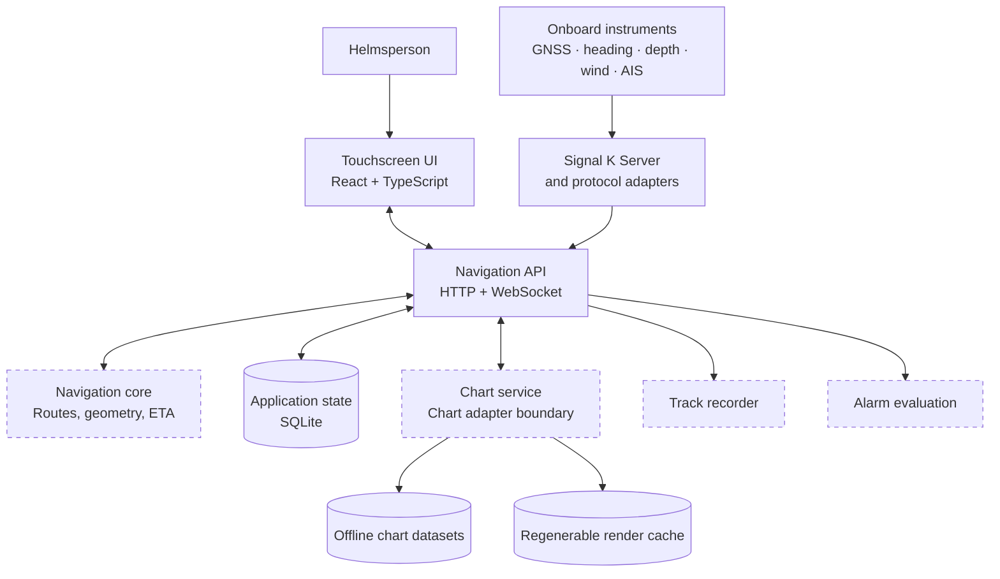
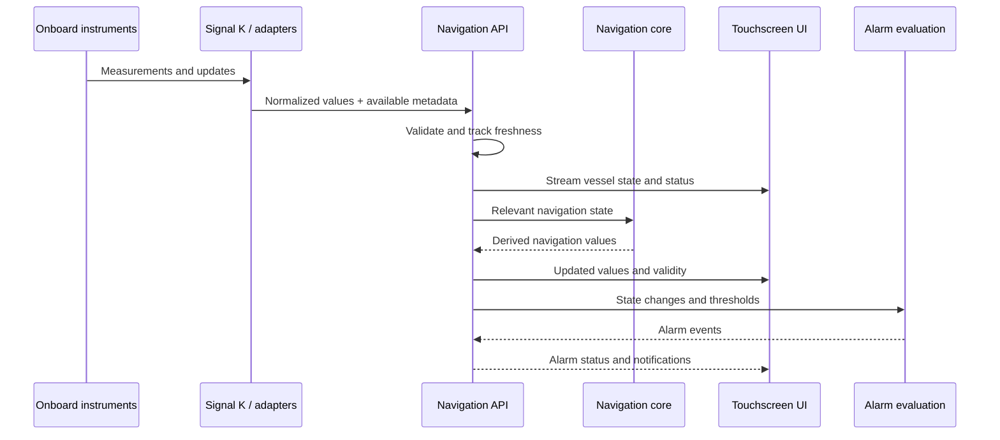
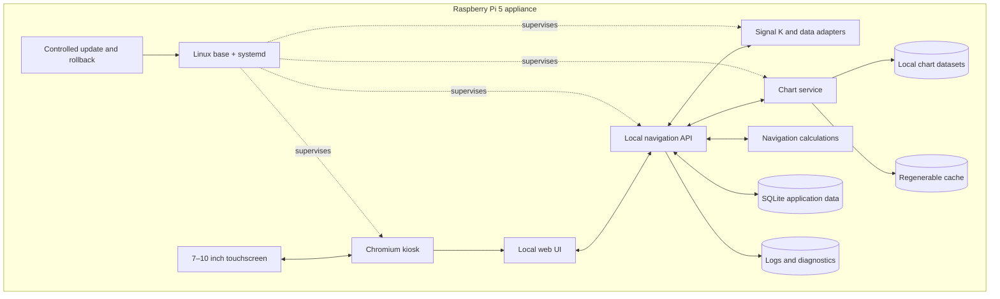

# Azimute One — Architecture Vision

**Status:** Proposed  
**Stage:** Discovery and feasibility  
**Product direction:** Touchscreen-first marine navigation appliance  
**Tagline:** Your course. Your instruments. Your sea.

## 1. Purpose

Azimute One aims to provide a modern, modular marine navigation platform that combines chart display, vessel position, navigation instruments, AIS, route and waypoint planning, track recording, and alarms in one coherent interface.

The primary appliance target is a Raspberry Pi 5 with a 7–10 inch touchscreen, but Azimute One must also run on conventional x86-64 (AMD64) computers. ARM64 is an initial deployment target, not an architectural restriction. The same core application, chart compatibility, data integrations, and user workflows should be available on both architectures wherever dependencies permit. The software should be usable without internet access and should leave room for future hardware, chart sources, and marine-data integrations.

This document records an architectural direction, not a commitment to implement every proposed component immediately. In particular, chart-engine feasibility must be established before the application structure is built around a particular engine.

## 2. Goals and non-goals

### Goals

- Provide a legible chart-centred interface suitable for touch input and compact displays.
- Support offline chart access and local persistence of routes, waypoints, tracks, and configuration.
- Ingest and normalize onboard data through Signal K and relevant NMEA interfaces.
- Display vessel position, heading, speed, depth, wind, AIS targets, and data-quality/freshness indicators where available.
- Support route planning, track recording, cross-track error, ETA, and configurable alarms as the system matures.
- Run as a recoverable appliance with controlled software updates, diagnostics, and resilience to power interruption.
- Support both ARM64 (including Raspberry Pi 5) and x86-64/AMD64 Linux systems from the same codebase, with architecture-specific packaging only where required.
- Keep interfaces between the UI, chart rendering, marine data, and navigation calculations explicit and testable.

### Non-goals for the first release

- Replacing certified navigation equipment or the watchkeeper's judgement.
- Depending on a cloud service or a continuous internet connection for core navigation.
- Implementing every chart format or every instrument protocol from day one.
- Building a new chart-rendering engine before evaluating mature alternatives.
- Promising support for encrypted or commercially licensed chart formats before licensing and technical feasibility are understood.

## 3. Architectural principles

1. **Validate before standardizing.** Build a focused proof of concept for chart rendering, chart formats, and performance on the actual target hardware before finalizing the stack.
2. **Offline-first by design.** Network access may enrich the system, but local charts and core functions should not require it.
3. **Safety-related data must be explicit.** Preserve timestamps, source, validity, and freshness. Missing or stale sensor data must not silently look current.
4. **Separate presentation from navigation logic.** The UI should not own authoritative navigation calculations or alarm evaluation.
5. **Prefer reuse, with boundaries.** Use existing projects and libraries when technically suitable, actively maintained enough, and compatible with the desired distribution and licence.
6. **Test the failure modes.** Simulate lost sensors, invalid values, GPS jumps, network interruptions, full storage, and abrupt power loss.
7. **Keep the first deployment small.** Begin with the minimum number of processes and expand only where separation provides a clear reliability, security, or maintenance benefit.
8. **Be hardware-architecture agnostic.** Keep application logic and APIs portable across ARM64 and x86-64. Isolate native dependencies, system packages, and hardware-specific capabilities behind documented adapters.

## 4. Proposed runtime architecture

The following is a conceptual target. The first implementation may combine some responsibilities into fewer processes.

### User interface

**Candidate:** React, TypeScript, and Vite as a local single-page application.

Responsibilities:
- Chart viewport and overlays.
- Touchscreen navigation and compact instrument panels.
- Route and waypoint editing.
- Instrument status, AIS presentation, alarms, and configuration.
- Day/night presentation and clear stale-data states.

A local SPA is preferred over Next.js for the appliance UI because server-side rendering and a web deployment model are not primary requirements.

### Navigation API

A local service exposing documented HTTP endpoints for configuration, route/waypoint CRUD, chart catalogue and import operations, plus WebSocket or an equivalent streaming interface for live vessel state and events.

The UI should consume stable API contracts rather than access internal services or the database directly.

### Marine-data integration

**Candidate:** Signal K Server as the main integration and normalization point for onboard data, with NMEA 0183 and other required sources connected through supported adapters.

Responsibilities:
- Connect to available onboard data sources.
- Normalize values and expose live data to Azimute One.
- Preserve source and timestamp information where available.
- Surface unavailable, invalid, or stale data rather than inventing defaults.

Signal K and the Azimute One API should have distinct roles: Signal K handles marine-data integration; the local API exposes Azimute One's application-specific capabilities.

### Chart service and chart viewport

Use a chart adapter boundary so the application can evaluate and potentially replace the underlying chart implementation without rewriting route management, instrument panels, or the overall UI.

**Target platforms:** Linux on ARM64/aarch64 and x86-64/AMD64. Validate both during feasibility work; do not let a Raspberry Pi-specific dependency leak into the shared application layer.

**Candidate technologies to evaluate, not yet selected:**
- **MapLibre GL JS** for map viewport interactions and overlays. Do not assume it alone provides full marine chart format support or nautical portrayal.
- **GDAL/OGR and PROJ** for geospatial data access and coordinate transformations where appropriate.
- **SQLite** and suitable tile formats for local chart catalogues, metadata, and caching.
- Existing chart-rendering code such as the **OpenCPN chart subsystem**, subject to a feasibility review of integration complexity, dependencies, target-platform performance, and licensing.

Raster formats to investigate include KAP/BSB and GeoTIFF, alongside practical offline tile packaging such as MBTiles where suitable. Vector ENC support requires more than drawing features: S-57 data ingestion and S-52 portrayal rules, including scale-dependent display and safety-relevant features, need explicit evaluation. S-63 encrypted chart support is a separate technical and licensing milestone.

**OpenCPN chart compatibility is a product requirement.** The goal is to let users reuse existing chart directories and datasets without unnecessary duplication or conversion. Format names alone do not prove compatibility: the chart engine, portrayal, projections, plugins, encryption, licensing, and vendor restrictions all matter.

The feasibility assessment should classify each candidate format as: (1) supported through a reusable engine or library, (2) supported through an adapter or port, (3) dependent on a vendor-authorized integration, or (4) unsupported/deferred with the reason documented. Priority candidates include BSB/KAP raster charts, S-57 ENC with appropriate S-52 portrayal, GeoTIFF, MBTiles where suitable, and commonly used OpenCPN legacy or plugin-provided chart sources. CM93, S-63, O-Charts, NV, and other proprietary/encrypted formats require individual technical and legal review; no compatibility promise should be made before validation.

Chart import should ideally reference user-selected chart directories rather than copy large collections. The application should index chart coverage and metadata, report unsupported datasets clearly, and preserve the original files. The project must not claim support for a chart format until its rendering, portrayal, coordinate handling, and licensing have been validated.

### Navigation core

A small, well-tested calculation module/service for functions that benefit from a clean boundary and deterministic tests, such as route geometry, cross-track error, distance/bearing, ETA, and relevant navigation-state calculations.

C++ is a candidate for performance-sensitive native functionality, but it should not be used by default for every calculation. Simple calculations may be better kept in TypeScript initially if testing and performance support that choice.

### Persistence

**Candidate:** SQLite for application-owned state, including:
- Routes, waypoints, and tracks.
- User settings and device configuration references.
- Chart catalogue metadata and import status.
- Application state that must survive restarts.

Large chart datasets should be managed separately from the application database. Cache data should be regenerable and should not be treated as the sole copy of important user data.

### Track recorder and alarm evaluation

Track recording and alarm evaluation should have service/API boundaries independent of the visual components. Loss or restart of the UI must not be allowed to silently suppress an alarm that the application claims to evaluate independently.

The exact process boundaries and alarm guarantees require validation during the prototype stage.

### Architecture diagrams

These diagrams communicate the proposed boundaries and flows; they are conceptual, not a finalized deployment specification. The chart-engine choice and exact process boundaries remain open until the feasibility phase.

#### Logical component view



The UI talks to the application through stable APIs. Marine data arrives through Signal K and protocol adapters; chart rendering is isolated behind an adapter so the underlying engine can be changed after evaluation. Dashed outlines indicate components whose final boundaries are still provisional.

#### Live-data flow



The sequence is illustrative. Exact interfaces and whether alarm evaluation runs in a separate process are decisions for the prototype. Values should retain timestamps, source information where available, and validity/freshness so missing or stale data is not presented as current.

#### Raspberry Pi appliance view



The appliance is intended to work locally without a cloud dependency. Persistent user data and installed charts are kept separate from regenerable cache and versioned application releases. The precise service split, update mechanism, and storage layout will be validated during appliance hardening.

---

## 5. Conceptual repository structure

This is a proposed future layout for discussion only. **Do not create this project skeleton yet.** The immediate deliverable is architecture documentation and feasibility decisions.

```text
Azimute-One/
├── apps/
│   ├── helm-ui/                 # React + TypeScript + Vite
│   ├── navigation-api/          # Local HTTP and streaming API
│   └── setup-ui/                # Device, network, and chart setup
├── libs/
│   ├── ui-design-system/
│   ├── chart-viewport/
│   ├── chart-overlays/
│   ├── marine-types/
│   ├── navigation-client/
│   └── test-fixtures/
├── services/
│   ├── navigation-core/         # Only where native code is justified
│   ├── chart-service/           # Catalogue and chart-engine adapters
│   ├── track-recorder/
│   └── alarm-service/
├── integrations/
│   ├── signalk/
│   ├── nmea0183/
│   ├── gnss/
│   └── ais/
├── packages/
│   ├── api-contracts/
│   ├── navigation-math/
│   └── config-schema/
├── os/
│   ├── image/
│   ├── systemd/
│   ├── kiosk/
│   ├── networking/
│   ├── security/
│   └── updates/
├── simulator/
│   ├── nmea-replay/
│   ├── ais-replay/
│   └── voyage-scenarios/
├── tests/
│   ├── integration/
│   ├── hardware/
│   ├── performance/
│   └── acceptance/
├── docs/
│   └── architecture/
│       └── vision.md
├── nx.json
├── pnpm-workspace.yaml
├── package.json
└── README.md
```

Potential tooling includes Nx and pnpm for the TypeScript workspace, with CMake only if native C++ components are introduced. This tooling is provisional until the chart-engine proof of concept has been completed.

## 6. Data and interface contracts

The following interfaces are proposed:
- **Marine data:** Signal K APIs and streaming updates, with explicit source/timestamp/validity semantics.
- **Application API:** HTTP for durable operations such as routes, configuration, and chart imports.
- **Live application state:** WebSocket or a comparable local event stream for vessel state, AIS updates, and alarms.
- **Chart adapter:** a documented interface for opening datasets, querying metadata, rendering the viewport, and reporting unsupported or invalid chart content.
- **Storage boundary:** application-owned data through a persistence layer; no direct database access from UI components.

A normalized vessel-state model should distinguish at least value, timestamp, source where known, and validity/freshness. The precise schema should be designed alongside the first working data integration, not frozen prematurely.

## 7. Appliance and operating-system strategy

**Candidate base:** 64-bit Raspberry Pi OS Lite or another appropriately supported Debian-based image, with a controlled Chromium kiosk for the local UI and systemd-managed services.

Design considerations:
- Start and recover services predictably after boot.
- Keep user data and chart data separate from versioned application releases.
- Provide diagnostics without requiring an internet connection.
- Use storage appropriate for continuous writes and consider SSD options.
- Monitor temperature, storage capacity, and service health.
- Validate behaviour during brownouts and abrupt power loss.
- Use versioned releases with integrity checks, health checks, and a rollback path.
- Avoid unattended OS upgrades until a tested update and recovery process exists.

Illustrative data locations, subject to the final packaging approach:

```text
/opt/azimute-one/              # Versioned application releases
/etc/azimute-one/              # Device configuration
/var/lib/azimute-one/          # Database and persistent state
/var/lib/azimute-one/charts/   # Installed chart datasets
/var/cache/azimute-one/        # Regenerable caches
/var/log/azimute-one/          # Diagnostic logs
```

An A/B-style release strategy is one option: validate a new release, switch the active version, run health checks, and revert if the essential services fail. The exact mechanism should be chosen after the first appliance prototype.

## 8. Testing strategy

Testing must cover both ordinary behaviour and failures.

- **Unit tests:** navigation math, coordinate transformations, data validation, configuration, and alarm conditions.
- **Chart tests:** known geographic fixtures, coordinate reference systems, scale changes, chart boundaries, and supported-feature portrayal.
- **Replay tests:** recorded or synthetic NMEA/Signal K and AIS streams with deterministic scenarios.
- **Integration tests:** sensor loss, stale data, malformed input, reconnects, API restarts, and persistence recovery.
- **Hardware tests:** rendering responsiveness on the target Raspberry Pi and display, sustained operation, temperature, and storage behaviour.
- **Appliance tests:** boot/reboot, interrupted updates, power loss, low disk space, backup/restore, and rollback.
- **Acceptance tests:** verify expected behaviour using documented scenarios and independent checks for important navigation calculations.

Performance targets should be measured and agreed on after the target hardware and chart engine are selected.

## 9. Delivery roadmap

### Phase 0 — Chart and integration feasibility

Before building the application skeleton:
1. Create a chart compatibility inventory based on the formats and chart sources OpenCPN users are likely to already have.
2. Test real sample datasets for priority raster and vector formats on the target Raspberry Pi/display; evaluate S-57 ingestion and S-52 portrayal rather than treating vector decoding alone as sufficient.
3. Investigate OpenCPN chart subsystem and plugin reuse, dependencies, integration cost, licences, and whether chart directories can be reused without conversion or duplication.
4. Create an integration inventory for marine protocols and hardware-facing features. Prefer Signal K as the standard marine-data integration boundary, and investigate OpenCPN/Signal K source implementations, drivers, protocol adapters, simulators, recorded data, and test fixtures.
5. For each integration, document supported models/protocols, ARM64/Raspberry Pi suitability, reuse approach, licence and vendor restrictions, test assets, and what still requires physical hardware.
6. Benchmark chart pan/zoom, memory, startup, and representative live-data replay.
7. Record decisions, rejected alternatives, compatibility gaps, and hardware dependencies in Architecture Decision Records (ADRs).

**Exit criterion:** a documented chart compatibility matrix and integration feasibility inventory, plus a working chart proof of concept on the target hardware. Any unsupported chart or hardware integration must have an explicit reason and an agreed disposition.

### Phase 1 — UI foundation

- Establish the TypeScript workspace only after Phase 0.
- Build the touchscreen layout and chart viewport.
- Show a simulated vessel position and basic overlays.
- Add pan, zoom, recentering, and day/night presentation.
- Establish accessible interaction patterns for use at sea.

### Phase 2 — Marine data

- Integrate Signal K.
- Display available GNSS, SOG/COG, heading, depth, wind, and AIS data.
- Surface missing, invalid, and stale values.
- Add replay-based integration tests.

### Phase 3 — Navigation features and chart correctness

- Add routes, waypoints, and track recording.
- Implement and test cross-track error and ETA.
- Introduce selected alarms, including relevant position/anchor and man-overboard workflows, with careful attention to their limitations.
- Complete the agreed chart-format and portrayal work.
- Test with replay scenarios and independent geographic references.

### Phase 4 — Appliance hardening

- Build a reproducible OS image and kiosk experience.
- Add device setup, diagnostics, persistent storage, and backup/restore.
- Implement controlled updates and rollback.
- Test power interruption, storage exhaustion, temperature, and long-duration operation.

These estimates and phase boundaries are provisional; the chart-engine feasibility work should inform the detailed plan.

## 10. Open decisions

1. Which chart engine can meet raster and vector requirements on the target hardware without excessive integration cost?
2. What chart formats are required for the first usable release, and what are the licensing constraints for each data source?
3. Is OpenCPN subsystem reuse technically and legally appropriate for this project?
4. Which Raspberry Pi OS/base image and release-update strategy provide the best maintainability?
5. Which services need separate processes for reliability, and which can initially be combined?
6. What are the minimum acceptable performance targets for chart pan/zoom, startup, and live-data updates?
7. What backup, recovery, and alarm guarantees can be realistically validated in the initial appliance?

Each significant decision should be captured as an ADR under `docs/architecture/adr/` once that documentation structure is established.

## 11. Safety, licensing, and project status

Azimute One is an early-stage project. Until it has been rigorously tested and its limitations clearly documented, it must be treated as supplementary navigation equipment—not as a replacement for certified equipment, official chart requirements, or prudent seamanship.

Software licences and chart/data rights are separate questions. The project must review and comply with the licences of any reused code and must not assume that publicly accessible chart data is free to redistribute or use without restriction.
